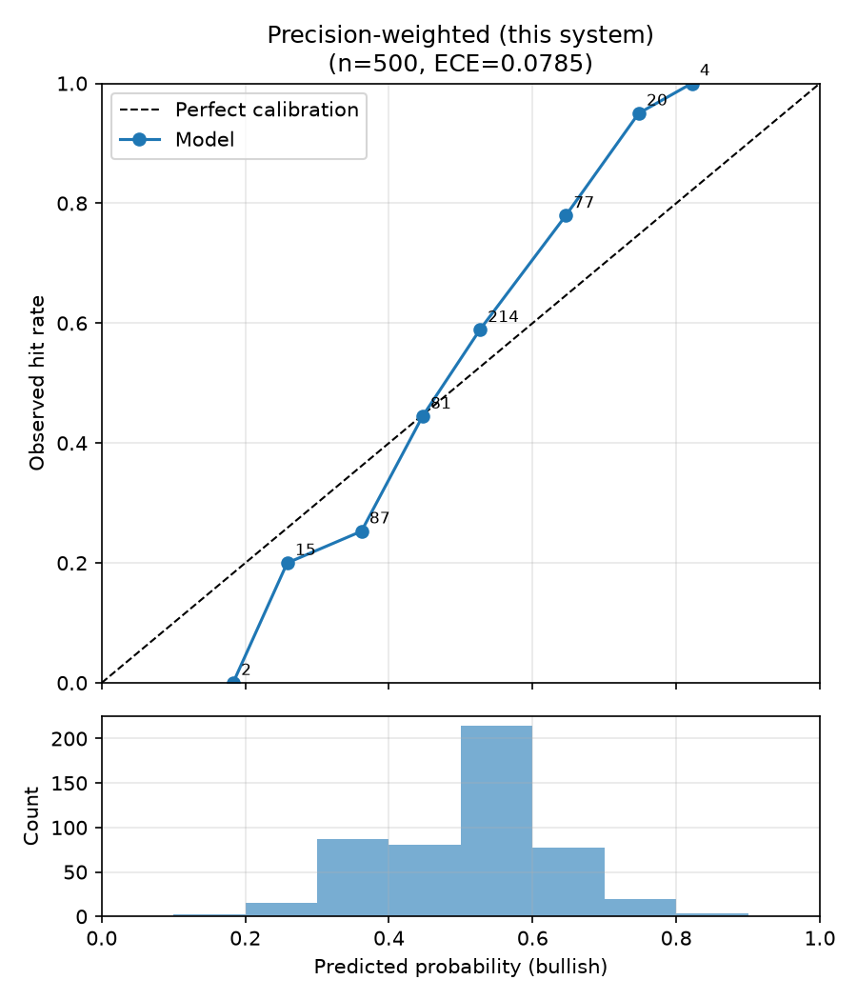
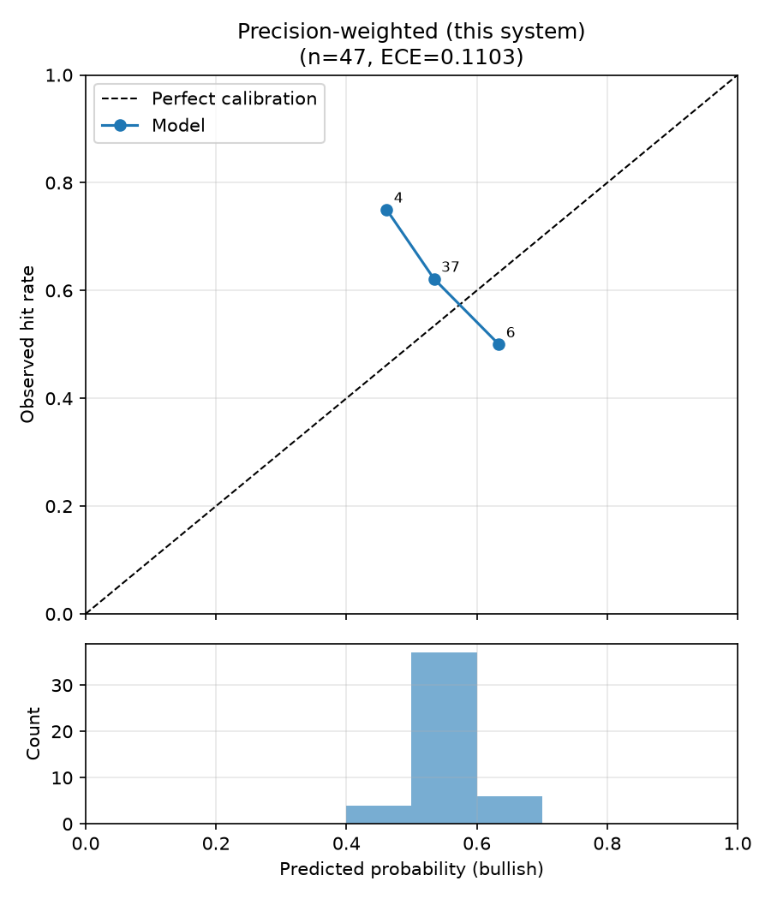

# 多代理人精度加權投資研究系統

**Precision-Weighted Multi-Agent Investment Research System**


🔗 **研究紀錄網站：<https://jamesleecy.github.io/precision-weighted-investment-agent/>**（研究結果，非投資建議）

借用神經科學**預測處理框架（predictive processing）**中的 precision
weighting 概念建構的多智能體投資研究系統：多個專家 Agent（財報、新聞事件、總經/籌碼、供應鏈）
各自產出帶信心值的判斷，仲裁層依各 Agent 的**歷史準確度**（Brier score
EMA 的倒數，即「精度」）動態加權合成投資論點——可靠度越高的來源權重越大，
系統從均等權重（loose coupling）隨證據累積收斂到以可靠來源為主導
（tight coupling）。鎖定台股 AI 供應鏈之被動元件族群。

```
 財報 Agent      新聞事件 Agent    總經/籌碼 Agent    供應鏈 Agent
 (規則式/LLM)    (規則式/LLM)      (規則式/LLM)       (規則式/LLM，知識圖譜)
      │               │                 │                  │
      └───────────────┴────────┬────────┴──────────────────┘
                  ▼
     精度加權仲裁層  final_score = Σ(precisionᵢ·κᵢ·sᵢ) / Σ precisionᵢ，κᵢ = |2pᵢ − 1|（確信度）
                  ▼
     投資論點 + 不確定性區間 + evidence trace
                  ▼ (T+20 交易日後)
     回測評估 → Brier score → 更新各 Agent 精度（EMA）→ 回饋仲裁層
```

## 核心結果

### 回測成績單

完整表格（所有策略、兩個股票池）見 **[docs/scorecard.md](docs/scorecard.md)**，由 `analysis/scorecard.py` 從 `reports/` 產生。
含息總報酬、扣交易成本，每 21 個交易日換倉；Sharpe = 年化報酬 ÷ 年化波動（無風險利率 0）。

**無選股偏誤股票池**（每年成交值前 100 檔、含下市股，2019-01 ~ 2026-05，8,475 筆 walk-forward 預測、85 期）：

| 策略 | 方向準確率 | 年化報酬 | Sharpe | 最大回撤 | 累積報酬 |
|---|---|---|---|---|---|
| 單一 Agent（財報） | 51.2% | +33.6% | 1.24 | −47.9% | +679% |
| 精度加權合併（3 Agent） | 50.8% | +22.1% | 0.74 | −59.1% | +311% |
| 產業中性做多（財報，前 1/3） | — | +35.0% | 1.25 | −46.9% | +740% |
| 等權持有全部股票 | — | +29.9% | 1.14 | −43.8% | +538% |
| **0050（大盤）** | — | +30.7% | **1.49** | **−31.6%** | +566% |

**5 檔被動元件**（2024-01 ~ 2026-05，135 筆 walk-forward 預測、27 期）：

| 策略 | 方向準確率 | 年化報酬 | Sharpe | 最大回撤 | 累積報酬 |
|---|---|---|---|---|---|
| 單一 Agent（財報） | 47.8% | +9.6% | 0.31 | −18.1% | +23% |
| 精度加權合併（財報 + 新聞） | 45.5% | −5.5% | −0.24 | −22.2% | −12% |
| 等權持有 5 檔 | — | +42.3% | 1.07 | −25.6% | +121% |
| **0050（大盤）** | — | +60.9% | **2.48** | −15.8% | +192% |

重點：**方向準確率低於「永遠猜上漲」**（53.4% / 54.8%），Agent 不會判斷漲跌；**風險調整後沒有贏過大盤**
（Sharpe 都低於 0050）。唯一的正面結果是財報 Agent 在無偏誤股票池上的產業內選股：累積報酬比等權持有多
約 140–200 個百分點，但回撤也比 0050 深。

**樣本外**（[說明](docs/overfitting_controls.md)、[數字](docs/oos_report.md)）：財報規則在 2026-07 用 5 檔、2023 年後的資料訂定後
沒有再調參，所以無偏誤股票池的 2019–2022 對規則是樣本外。21 種取樣起點中位數：

| | 2019–2022（樣本外） | 2023–2026/05（樣本內） |
|---|---|---|
| 財報 Agent 原規則：Sharpe／相對等權 IR | 0.48／+0.13 | 1.87／+0.76 |
| 產業中性做多（事後決定的設計）：Sharpe／IR | 0.57／+0.26 | 1.80／+0.80 |
| 等權持有／0050：Sharpe | 0.59／0.73 | 1.61／2.09 |

樣本外 IR 只剩樣本內的約 1/6 ~ 1/3，Sharpe 兩段都不如 0050；扣掉嘗試次數的 Deflated Sharpe 不顯著（≤ 0.25）。
乾淨的答案只能靠已凍結規則的前瞻驗證累積。

**其他訊號與進出場濾網**（詳見[報告](docs/technical_timing_report.md)）：產業內相對估值、技術面 Agent（K 線、均線、量價、
支撐壓力）、動能、短期反轉，沒有一個在 2019–2022 樣本外與 2023–2026 兩段都有效——技術面與動能只在 2023 年後的多頭有效、
樣本外轉負；反轉剛好相反；估值兩段都為負。0050 跌破 200 日線轉現金的大盤濾網能把最大回撤降低約 40%，
但樣本外 Sharpe 反而下降（0.57 → 0.37）；沒有任何組合的 Sharpe 贏過 0050 買進持有。

**短期反轉、過度反應、產業領先落後**（5 日預測期，詳見[報告](docs/short_term_reversal_report.md)）：1 日反轉在
同一收盤成交時兩段都顯著（產業內 IC +0.03，t 2.4–3.4），但晚一天成交只剩約 30%；每 5 日換手 1.3 以上，
扣掉 0.3% 證交稅後所有版本都虧損。量能條件與領先股訊號都沒有一致的證據。改成只在財報組合換倉時用反轉
延後賣出（[報告](docs/reversal_execution_report.md)），換手降低約 10%，但 Sharpe 不變（樣本外 0.57–0.64，0050 為 0.72）。

**子產業分類**（[報告](docs/subindustry_report.md)）：從櫃買中心產業價值鏈平台建立 63 種子產業。財報 Agent 改用子產業分組沒有變好
（組內 IC 略降）；估值訊號在「子產業 × 市值五分位」裡樣本外 IC 轉正（+0.014），但 2023 年後仍為負、組合扣成本後虧損。
股票池每年只有 100 檔，只有 44% 的股票所在子產業有 5 檔以上，是主要限制。

**基本面選股 + 技術面每日進出場**（[報告](docs/fund_tech_daily_report.md)，每日回測）：個股每日均線進出場讓年換手升到 17–30 倍，
樣本外年化報酬從 +19.9% 掉到 +3–7%；財報 + 技術面的權重混合只在 2023 年後有效。所有選股組合的 Sharpe 都低於 0050。

**配置研究**（[報告](docs/allocation_study_report.md)，研究結果，非投資建議）：7 種 0050 擇時規則中，200 日線 ±2% 緩衝帶的樣本外 Sharpe
最高、2023 年後與買進持有相當（0.99 / 2.42 vs 0.77 / 2.41）、回撤減半，但所有擇時規則的年化報酬都低於買進持有。0050 擇時部位與財報選股
各半混合，兩段 Sharpe 都高於 0050 買進持有、報酬不低於它；要最大化報酬則是 100% 選股部位（樣本外 +19.9%，回撤 −44%）。
個股權重方法沒有一種兩段都勝出（市值加權只在 2023 年後領先）。

**月營收驚奇 SUE**（[報告](docs/revenue_surprise_report.md)，依文獻研究第 1 名）：以公告期限後進場，SUE 是本專案第一個在
2019–2022 與 2023–2026 兩段都顯著的訊號（產業內 IC +0.032 / +0.059，t 2.0 / 2.9；持有 60 日升到 +0.044 / +0.091），延後 1–10 日進場仍有效。
每日回測：SUE 產業中性組合 Sharpe 0.73 / 2.32（0050 為 0.75 / 2.40），報酬高很多；與 0050 擇時部位各半混合為 0.88 / 2.64，
兩段都高於 0050。另發現現行財報 Agent 的月營收比實際公告晚約一個月使用。已建立前瞻規格 fv2（[說明](docs/forward_validation.md)、
[報告](forward/fv2/REPORT.md)），2026-10-13 起每月自動記錄。加入季報盈餘驚奇或拉長持有都沒有更好
（[報告](docs/revenue_surprise_plus_report.md)）：盈餘驚奇在法定期限時點下偏弱、合成反而稀釋；每 3 個月換倉換手減半、Sharpe 相當。

**腿池第一輪（全市場市值前 300 檔，[報告](docs/leg_pool_report.md)）**：依 WorldQuant 流程以固定包裝測 11 條腿（月營收驚奇 + 低波動、殘差波動、異常量、Amihud、季節性、券資比、融券增量、投信買超、外資持股變化），
以台指期對沖後的純 alpha 年化 Sharpe 為主要指標。所有腿與 700 個組合都不為正：產業內等權做多 vs 市值加權（台積電主導）指數的結構差，
使「持有整個股票池」本身就是 −0.25 / −0.67（2019–2022 / 2023–2026/04）。扣掉此基準後，**月營收驚奇的選股超額 Sharpe 為 1.24 / 1.73、8 年全為正**，
其餘 10 條腿扣成本後都為負，沒有組合兩段都勝過月營收驚奇單獨。改成產業內市值加權或市值加權多空（扣實際借券費）後結構差縮小，但月營收驚奇的選股能力也被稀釋，兩段都沒有同時為正（[報告](docs/hedge_construction_report.md)）。月營收驚奇 + 兩日連漲進場、連跌出場的技術面規則讓換手升到 35 倍、Sharpe 0.50 / 1.06，差於不看技術面的月換倉（0.91 / 1.42）；只保留進場規則時為 1.06 / 1.56（[報告](docs/sue_breakout_report.md)）；拆解後唯一兩段一致的來源是「漲幅愈大加碼愈多」，報酬多但波動也高，Sharpe 只多約 0.09（[報告](docs/sue_breakout_decompose_report.md)）；進一步檢驗後，這個效果主要是偏向高波動股票、集中在 2023 年後，不是動能（[報告](docs/sue_tilt_momentum_report.md)）。改成等權多空、放空端只用借得到且借券費 ≤ 5%／年的股票並扣實際借券費後，台指期對沖的 Sharpe 為約 0.5 / 1.15（年化約 +5%、波動 6%），是第一個兩段都為正的可交易對沖建構；資金 2 億元內中小型股的可借額度不是瓶頸，費率才是（[報告](docs/borrow_capacity_report.md)）。改成每 3 個月換倉後換手從 21 倍降到 9 倍，Sharpe 升到 0.79 / 1.85，兩段都提高（[報告](docs/ls_turnover_report.md)）。三種換倉起點都通過（三份資金錯開平均 0.93 / 1.79），已凍結為前瞻規格 **fv3**，每月自動記錄（[說明](docs/forward_validation.md)、[報告](forward/fv3/REPORT.md)）。依文獻再測營收動能延伸與持續性動能：**營收創新高**（本月營收 ÷ 前 24 個月最高）是第二個兩段都顯著的訊號，與月營收驚奇各半合成後 Sharpe 1.22 / 2.13、8 年全正；持續性動能仍無效（[報告](docs/revmom_persist_report.md)）。合成版本另立為前瞻規格 **fv4**，與 fv3 平行記錄（[報告](forward/fv4/REPORT.md)）。營收創新高改用前 12 / 36 個月最高也都通過；彩券型股票（MAX、漲停）濾網在月營收驚奇名單內反而有害；股權分散（集保）缺少免費歷史資料，無法回測（[報告](docs/max_rec_robust_report.md)）。4 條借券腿（借券賣出餘額比、增量、費率、需求量）中，餘額比與費率的 60 日 IC 兩段顯著，但扣成本後的多空與合成都在 2019–2022 變差，不採用（[報告](docs/lending_legs_report.md)）。擴大到市值前 500 檔後，月營收驚奇等權多空更強（1.45 / 1.87），但與營收創新高合成的優勢只在 2023 年後出現、2019–2022 未勝過單獨（[報告](docs/top500_report.md)）。前 500 檔版本另立為前瞻規格 **fv5**（[報告](forward/fv5/REPORT.md)）。把月營收驚奇多空與 0050 擇時各半混合，前 500 檔兩段 Sharpe 1.38 / 2.17、最大回撤 −11.6%（0050 為 0.73 / 1.90、−34%），但年化報酬低於 0050；月營收驚奇做多不對沖仍輸 0050，改每 3 個月換倉換手減半以上、績效不變（[報告](docs/blend_longonly_report.md)）。**更正**：用 2004 年起的 0050 做樣本外驗證後，200 日線 ±2% 擇時在挑選時未用的 2004–2018 年 Sharpe 與報酬都輸給買進持有，只有回撤較小；擇時帶來的 Sharpe 提升主要是挑選偏誤，混合的好處來自多空與大盤的低相關（[報告](docs/timing_oos_report.md)）。改用國發會景氣燈號逆向調整 0050 持股（藍燈多、紅燈少），方向正確但相對同平均持股只多約 0.3–1.2%／年、不顯著，也沒有避開 2008 年大跌（[報告](docs/business_cycle_timing_report.md)）。台指 VIX（用台指選擇權結算價自行計算，與期交所官方值相關 0.999）用於恐慌時加碼或波動率管理，扣成本前就沒有優勢（[報告](docs/vix_timing_report.md)）。另測隔夜／盤中報酬拆解、殘差反轉、季節性動能，7 個訊號都沒有選股能力（[報告](docs/reversal_signals_report.md)）。

### 評估指標速覽

- **平均 Brier score**（越低越好）：每筆預測先轉成「看多機率」p（bullish
  → confidence、bearish → 1−confidence、neutral → 0.5），與實際結果
  o ∈ {0,1}（20 個交易日後報酬是否為正）計算 **(p − o)²** 再取平均。它同時
  懲罰「方向錯」與「過度自信」：0 是完美預測，**0.25 是「永遠說 50%」的
  無資訊基準**——低於 0.25 才代表模型帶有資訊。有方向的訊號信心下限為
  0.5，確保 bullish 的 p 不會落在看空側。
- **方向準確率**（越高越好）：非 neutral 的預測中，方向與實際報酬一致的
  比例。只看對錯、不看信心，與 Brier 互補。
- **ECE, Expected Calibration Error**（越低越好）：衡量「模型說 70% 時，
  是否真的有 70% 命中」。做法是把預測依機率分成 10 桶，計算每桶
  |平均預測機率 − 實際命中率|，再依樣本數加權平均。ECE = 0 代表完美校準；
  一個方向常對但總是過度自信的模型，方向準確率可以很高、ECE 卻很差。

**真實資料回測**（FinMind，5 檔被動元件 × 2024-01~2026-05，135 個預測事件，
詳見[完整版報告](docs/finmind_full_report.md)；另有 3 檔 47 事件的
[縮小版](docs/finmind_scoped_report.md)）：

| 策略 | 平均 Brier ↓ | ECE ↓ |
|---|---|---|
| Baseline A：單一 Agent（財報） | 0.2593 | 0.1174 |
| Baseline B：簡單平均合併 | **0.2540** | **0.0295** |
| 本系統：精度加權合併 | 0.2542 | 0.0297 |

三者 Brier 皆**高於** 0.25 的無資訊基準：目前的規則式 Agent 沒有預測力，
合併只是讓機率更靠近 0.5、校準更好。

**報酬層級**（long/neutral 組合、含息總報酬、扣交易成本，27 期）：所有策略
皆顯著落後 0050（期間 0050 累積 +192%，2 Agent 合併 −12% 到 +53%，單一 Agent
+23%），橫斷面 Rank IC 為負（不顯著）——規則式 Agent 目前沒有選股能力。組合報酬
對訊號公式極度敏感：修訂規格 5.2 前，3 Agent 合併曾達 +182%，但那只是多頭中
多數時間持股的結果。
詳見[完整版報告第 4 節](docs/finmind_full_report.md#4-報酬層級評估2026-10-06-新增)。

**Phase 2：加入總經/籌碼 Agent**（3 Agent，同 135 事件，詳見
[Phase 2 報告](docs/phase2_macro_report.md)）：合併 Brier 0.2540 → 0.2530；
三個 Agent 精度仍相近（比值 ≤ 1.24），精度加權依然等於或略輸簡單平均。

**LLM 判讀實驗**（地端 qwen3:8b，詳見[實驗報告](docs/llm_experiment_report.md)）：
改用 LLM 後各 Agent 精度確實拉開（比值 1.35–2.63），但 LLM 嚴重過度自信、
總經判讀一律看空，Brier 全面劣於規則式（合併 0.2805 vs 0.2538），精度加權
仍略輸簡單平均。（數字為規格 5.2 修訂前）

**Agent 層級重新校準**（詳見[校準報告](docs/calibration_report.md)）：合併前以
walk-forward 收縮校準修正各 Agent 的過度自信，LLM 合併 Brier 0.2726 → 0.2544，
但仍未低於 0.25。校準後 LLM 的精度比縮回 1.04–1.28——原本
的分化是過度自信程度不同，而非資訊量不同。目前的瓶頸在 Agent 本身的資訊量。

**新聞內文與供應鏈 Agent**（詳見[報告](docs/news_content_and_supply_chain_report.md)）：
新聞內文覆蓋率 36%（Google News 轉址無法解析），在規則式判讀下反而讓新聞 Agent
變差（Brier 0.2531 → 0.2640），改用 LLM（qwen3:8b）判讀也一樣變差（0.2718 → 0.2877）。供應鏈 Agent 的機率品質最差（0.2656），樣本內
橫斷面 IC +0.160（t = 1.71）。

**供應鏈訊號驗證**（詳見[驗證報告](docs/supply_chain_validation_report.md)）：依 2024 年度年報修訂
圖譜，並回測 2019–2026。供應鏈訊號**不穩定**：樣本內的 +0.160 是 21 種取樣起點中的最大值，
2019–2023 樣本外 IC 為負（v1 −0.070、v2 −0.128）。

**擴大股票池**（41 檔：被動元件、半導體設備、功率元件、AI 伺服器與供應鏈，2019–2026，
詳見[報告](docs/expanded_universe_report.md)）：三個 Agent 都沒有可靠的同產業選股能力。
唯一兩期一致的訊號是財報 Agent 連續分數的產業內 IC（約 +0.02 ~ +0.03，不顯著）；
供應鏈 Agent 只在跨產業排序上為正（族群輪動），產業內為負。股票池為事後挑選的 AI
贏家，絕對報酬有選股偏誤，比較基準改用等權持有同一股票池。

**連續輸出模式**（`--agent-output continuous`，詳見[報告](docs/continuous_output_report.md)）：
規則式 Agent 改由分數直接映射機率 p = σ(ln3 · score · 證據強度)，不再門檻化。財報 Agent
的產業內 IC 從約 0 回到 +0.02 ~ +0.03；41 檔合併組合在 2019–2023 相對等權持有每期 +1.58%
（21 種取樣起點全為正，選股貢獻 +0.97%），但 2024–2026 完全消失。在選股偏誤與多重比較下，
仍屬未經證實的弱訊號。

**無選股偏誤股票池**（271 檔、每年依當時成交金額選前 100 檔、含下市公司，詳見
[報告](docs/pit_universe_report.md)）：**財報 Agent 的產業內選股能力重現了**——產業內 IC
2019–2026 為 +0.029（t 2.16），兩個期間、21 種取樣起點全部為正；單獨持有財報 Agent 看多的
股票，扣成本後相對等權持有每期 +0.26%（t 1.90，約年化 3%）。合併策略在 41 檔上的優勢
沒有重現（選股偏誤），總經與供應鏈 Agent 的加入反而稀釋了財報 Agent。

**產業內 IC 加權合併**（詳見[報告](docs/ic_weighting_report.md)）：以已到期預測的產業內 IC
為權重，自動把總經與供應鏈 Agent 壓到接近 0，3 Agent 合併從每期 −0.44% 回到 +0.30%；
但沒有勝過直接只用財報 Agent。每期 IC 的標準差是平均的 4 倍，用 2 年資料估計「誰有能力」
的誤差和訊號一樣大——這也是精度加權在真實資料上從未奏效的根本原因。因此 2026-10-10 起
config 的預設合併只放財報 Agent。

**產業中性組合**（詳見[報告](docs/sector_neutral_report.md)）：每個產業內依財報 Agent 取前 1/3、
產業權重與股票池相同，未扣成本相對等權每期 +0.42%（t 2.01）、產業內多空 +0.93%（t 2.42），
兩個子期間與 21 種取樣起點全部為正；扣成本後做多 +0.26%（加緩衝降低換手後 +0.35%，t 1.91）。
產業內排序能力能轉成報酬，但訊號小、主要損耗在換手。

**前瞻驗證**（詳見[操作說明](docs/forward_validation.md)、[最新報告](forward/REPORT.md)）：規則（財報 Agent、
連續輸出、無偏誤股票池、每月第一個交易日預測、持有 20 個交易日）於 2026-10-09 凍結並事先登錄評估
方式，程式碼指紋改動即拒絕預測，紀錄只能新增。開發未用過的 2026-06 ~ 09 回填 4 期：產業內 IC 平均
+0.005（t 0.07），在統計上不具意義；正式（live）紀錄自 2026-11 起累積。

**規格 5.2 修訂**（2026-10-07，詳見[校準報告第 8 節](docs/calibration_report.md#8-訊號公式修訂2026-10-07)）：
投票權重改為確信度 |2p − 1|，合併分數 = 2 × 合併機率 − 1，門檻為合併機率
0.55 / 0.45。毫無把握的 Agent 不再投票，訊號與機率一致。

**Synthetic 機制驗證**（20 seeds，來源可靠度刻意分化，詳見
[技術筆記](docs/technical_note.md)）：精度加權在 **17/20 seeds** 的
Brier 優於簡單平均。

兩組實驗合起來的結論：(1) 多 Agent 合併穩定優於單一 Agent；(2) 精度加權
相對簡單平均的增益，**只在來源可靠度實質分化時顯現**——真實回測中兩個
規則式 Agent 恰好同樣可靠（精度比僅 1.1），精度加權因此收斂到等權，這
本身是理論的正確行為而非機制失效。誠實的負結果與條件分析是本專案的
主要研究產出之一。

### 校準曲線（Reliability Diagram）怎麼看

上圖是預測機率 vs 實際命中率：**每個點代表一桶預測**（點旁數字 = 該桶
樣本數），x 座標是該桶的平均預測機率、y 座標是實際命中率；下方直方圖是
預測機率的分布。**點落在對角虛線上 = 完美校準**；點在線下方代表過度自信
（說 70% 但只中 55%），在上方代表過度保守。

**Synthetic 驗證**（500 筆預測，校準曲線緊貼對角線，ECE 0.062）：



**真實資料回測**（47 筆預測）：



讀真實資料這張圖要注意兩件事：(1) 預測機率集中在 0.4–0.7 的窄帶（下方
直方圖）——規則式 Agent 訊號溫和，合併後很少產生極端判斷，這是保守但
誠實的行為；(2) 三個桶中只有中間桶（n=37）有統計意義，左右兩桶各只有
4 和 6 筆，其偏離對角線主要是小樣本雜訊，不宜過度解讀。完整版回測
（5 檔 / 135 事件）已擴大樣本並印證同一結論，見[完整版報告](docs/finmind_full_report.md)。

## 快速開始

```bash
python3.11 -m venv .venv
.venv/bin/pip install -r requirements.txt        # Windows: .venv\Scripts\pip

# 單元測試（不需任何 API key）
.venv/bin/python -m pytest tests -q

# Synthetic 回測：模擬可靠度不同的 Agent，驗證精度加權機制
.venv/bin/python backtest/run_backtest.py --mode synthetic

# 真實資料回測（需 FinMind token：cp .env.example .env 並填入）
.venv/bin/python backtest/run_backtest.py --mode finmind \
    --tickers 2327.TW,2492.TW --start-date 2025-01-01 --step-days 21
```

輸出至 `reports/<mode>/`：比較報表（`comparison_report.md`）、校準曲線
（`calibration_*.png`）、逐筆預測（`backtest_results.csv`）。

### 執行模式與 API key

| 模式 | 需要的 key | 說明 |
|---|---|---|
| 測試 / synthetic | 無 | 完整驗證 schema、合併公式、冷啟動、指標 |
| finmind 回測 | `FINMIND_API_TOKEN`（免費註冊） | 兩個 Agent 以真實財報/新聞驅動（規則式判斷）。免費額度 600 req/hr，客戶端內建逐日快取與額度自動等待；`data_cache/` 已隨 repo 提供，重跑既有範圍不消耗額度 |
| + LLM 判讀 | `ANTHROPIC_API_KEY`，或地端 Ollama | Agent 改用 LLM 產出 signal/confidence/rationale，失敗時退回規則式。地端模型：`--llm-provider ollama --llm-model qwen3:8b`；與其他工作共用電腦時可用 `--llm-num-thread` 限制執行緒；回應快取於 `data_cache/llm/` |

## 系統設計

- **Agent 共同介面**（[agents/base.py](agents/base.py)）：`analyze(ticker, as_of_date) → AgentOutput`，
  輸出含 signal（bullish/bearish/neutral）、confidence（單次判斷的主觀信心）、
  rationale、evidence_refs、raw_features
- **precision ≠ confidence**：confidence 是 Agent 對單次判斷的信心；
  precision 是仲裁層追蹤的歷史可靠度 `1/(brier_ema + ε)`。投票權重 =
  precision × 確信度 |2p − 1|（「這個來源多可信 × 這次多有把握」），
  合併分數 = 2 × 精度加權合併機率 − 1
- **冷啟動**（[arbitrator/precision_tracker.py](arbitrator/precision_tracker.py)）：
  n < 5 的 Agent 精度取成熟記錄均值，無任何歷史時全體等權
- **走時序回測**（[backtest/run_backtest.py](backtest/run_backtest.py)）：
  精度只在 horizon 到期後更新；財報設公告遞延（月營收 40 天、季報 75 天），
  杜絕 look-ahead
- **評估**（[backtest/metrics.py](backtest/metrics.py)）：Brier score、
  Reliability Diagram、ECE、方向準確率；驗收 = 精度加權 vs 單一 Agent vs
  簡單平均的三方比較

## 專案結構

```
config/tickers.yaml     股票池與全部參數（horizon、閾值、EMA α、冷啟動門檻）
config/tickers_expanded.yaml  擴大股票池（41 檔，2019–2026，事後挑選）
config/tickers_pit.yaml       無選股偏誤股票池（271 檔，逐年成員見 universe_pit_membership.csv）
config/supply_chain_graph.json  供應鏈知識圖譜（依 2024 年報修訂，每條邊標註出處；v1 另存為 _v1）
agents/                 Agent 基底 + 財報/新聞/總經籌碼/供應鏈/技術面 Agent（LLM 可插拔）
arbitrator/             精度追蹤（Brier EMA）+ 合併公式 + Agent 層級重新校準 + 產業內 IC 加權
data/                   FinMind 抓取（快取/節流/額度等待）、含息還原價、總經/籌碼、供應鏈、新聞內文、RSS 新聞、向量庫
backtest/               walk-forward 回測 + 評估指標 + 報酬層級評估（vs 0050）
tests/                  182 個單元測試
forward/                前瞻驗證：凍結規格、預測 / 結算紀錄、自動報告
analysis/               訊號穩定性分析（分期 IC、產業內 IC、取樣起點穩健性）
site/                   研究網站（股票池、Agent 架構、逐股分析、前瞻驗證）；build_site.py 重新產生
reports/                synthetic / finmind_preliminary / finmind_scoped / finmind_full / finmind_macro / finmind_llm_qwen3 / finmind_news_content / finmind_llm_qwen3_content / finmind_supply_chain(_v2 / _long_v1 / _long_v2) 結果
docs/                   規格、技術筆記、回測報告
notebooks/              校準分析 notebook
```

## 文件

- **[目前有效的訊號總覽](docs/effective_signals.md)** — 有效（月營收驚奇、營收創新高）、部分有效、無效的訊號與前瞻驗證狀態（2026-10-14）
- [2026 第四季模型排名與產業營收趨勢](docs/outlook_2026q4.md) — 依 10/13 前瞻預測（fv4 / fv5）與 9 月營收整理（研究輸出，非投資建議）

- **[研究網站（公開版）](https://jamesleecy.github.io/precision-weighted-investment-agent/)**（GitHub Pages，`main` 分支根目錄的 `index.html`）。
  原始檔 [site/research-dashboard.html](site/research-dashboard.html) 為單一 HTML（下載後用瀏覽器開啟）：目前股票池、
  Agent 架構圖、2026 前瞻股票池 100 檔的財報特徵與預測、前瞻驗證 IC。
  每月前瞻驗證自動執行（`forward/run_forward.py auto --push`）有新預測或結算時會一併重建並推上 GitHub，公開版隨之更新；
  手動更新：`.venv/Scripts/python site/build_site.py`（架構圖在 claude.ai 由平台繪製；其他地方開啟時自動從 cdnjs 載入 mermaid 繪製）。
  線上版由 Claude 桌面 App 排程工作在檔案變動後自動重新發佈，見
  [前瞻驗證操作說明](docs/forward_validation.md)「線上網站重新發佈」
- [技術規格](docs/spec.md) — 系統的原始設計規格（v0.1）
- [技術筆記](docs/technical_note.md) — 預測處理框架的理論對應、synthetic
  實驗、誠實分析（M5 交付物）
- [真實資料回測報告（完整版）](docs/finmind_full_report.md) — FinMind 5 檔 /
  135 事件的完整版結果與逐項解讀
- [Phase 2 回測報告](docs/phase2_macro_report.md) — 加入總經/籌碼 Agent 的
  3 Agent 結果、消融與報酬拆解
- [樣本外與過度擬合控制](docs/overfitting_controls.md) — 樣本切分依據、樣本外 Sharpe / IR、Deflated Sharpe、控制做法與面試回答
- [回測成績單](docs/scorecard.md) — 方向準確率、Brier、Sharpe、最大回撤，兩個股票池對 0050 與等權持有
- [技術面、動能、反轉、估值與進出場濾網](docs/technical_timing_report.md) — 技術面 Agent、8 個訊號的產業內選股能力、
  大盤／個股濾網對 Sharpe 與回撤的影響
- [短期反轉、過度反應、產業領先落後](docs/short_term_reversal_report.md) — 5 日預測期、隔日 / 同一收盤成交、扣成本
- [用短期反轉降低財報組合交易成本](docs/reversal_execution_report.md) — 延後賣出、選股邊際偏好跌深、與緩衝規則比較
- [子產業分類](docs/subindustry_report.md) — 櫃買中心產業價值鏈平台、主要子產業選擇規則、財報 / 估值 / 領先落後的子產業版本
- [基本面選股 + 技術面每日進出場](docs/fund_tech_daily_report.md) — 每日回測、個股 / 大盤濾網、財報與技術面權重混合
- [配置研究](docs/allocation_study_report.md) — 7 種擇時規則、0050 擇時與財報選股的混合比例、個股權重方法
- [台股特有 alpha 文獻研究](docs/taiwan_alpha_literature.md) — 月營收驚奇、投信買超、融券借券、彩券型股票等候選策略與出處
- [月營收驚奇 SUE](docs/revenue_surprise_report.md) — 公告期限對齊、IC 與漂移、延後進場、每日回測與 0050 比較
- [強化月營收驚奇](docs/revenue_surprise_plus_report.md) — 季報盈餘驚奇、合成、每 1 / 2 / 3 個月換倉
- [腿池第一輪](docs/leg_pool_report.md) — 全市場市值前 300 檔、11 條腿單腿探針與本機枚舉、台指期對沖純 alpha 與股票池基準（[探針表](docs/leg_probe_top300.md)、[枚舉表](docs/leg_enumerate_top300.md)）
- [對沖結構差](docs/hedge_construction_report.md) — 產業內市值加權、市值加權多空與借券成本
- [連漲進場、連跌出場](docs/sue_breakout_report.md) — 月營收驚奇 + 兩日連漲依成交金額加碼、連跌出場
- [拆解進場規則](docs/sue_breakout_decompose_report.md) — 時點、成交金額加權、漲幅加權 8 個版本
- [漲幅加權是不是動能](docs/sue_tilt_momentum_report.md) — 兩日報酬、1/3/12-1 月動能、波動度傾斜與涵蓋迴歸
- [等權多空與可借量](docs/borrow_capacity_report.md) — 借券賣出額度、借券成交與費率、依資金規模的可覆蓋比例、等權多空回測
- [降低等權多空換手](docs/ls_turnover_report.md) — 每 1 / 2 / 3 個月換倉、持有緩衝
- [隔夜／盤中、殘差反轉、季節性動能](docs/reversal_signals_report.md) — 依 2023–2024 台股文獻的新反轉／動能訊號
- [營收動能延伸與持續性動能](docs/revmom_persist_report.md) — 營收創新高、年增率加速、3 個月年增率、持續性排名、frog-in-the-pan
- [股權分散、彩券型濾網與營收創新高穩健性](docs/max_rec_robust_report.md) — 集保資料可得性、MAX／漲停濾網、創新高 12 / 24 / 36 個月窗口
- [借券腿](docs/lending_legs_report.md) — 借券賣出餘額比、增量、借券費率、借券需求量
- [擴大到前 500 檔](docs/top500_report.md) — 前 300 vs 前 500：月營收驚奇、營收創新高合成、彩券型濾網、各腿
- [0050 擇時 + 多空混合、做多與降換手](docs/blend_longonly_report.md) — 資金分配與疊加、做多不對沖 vs 0050、做多每 3 個月換倉
- [擇時規則的樣本內／樣本外驗證](docs/timing_oos_report.md) — 2004 年起 0050、26 種規則、單一切割與滾動前進
- [景氣燈號逆向擇時](docs/business_cycle_timing_report.md) — 國發會景氣對策信號、依燈號與連續燈號調整 0050 持股
- [台指 VIX 擇時與波動率管理](docs/vix_timing_report.md) — 自算台指 VIX（TXO 結算價）、恐慌時加碼、波動率風險溢酬、波動率管理
- [產業中性組合報告](docs/sector_neutral_report.md) — 財報 Agent 的產業內排序轉成產業中性做多／多空組合、
  換手與成本、緩衝規則、敏感度
- [前瞻驗證操作說明](docs/forward_validation.md) — 凍結規則、每月流程、完整性機制
- [產業內 IC 加權報告](docs/ic_weighting_report.md) — 以產業內排序能力加權合併、
  權重演變、估計雜訊分析
- [無選股偏誤股票池報告](docs/pit_universe_report.md) — 逐年依當時資訊選股、含下市公司；
  財報 Agent 產業內選股能力的獨立驗證
- [連續輸出模式報告](docs/continuous_output_report.md) — 分數直接映射機率、
  排序資訊回收、合併組合的產業配置 / 選股拆解
- [擴大股票池報告](docs/expanded_universe_report.md) — 41 檔 × 2019–2026、產業內 IC、
  選股偏誤
- [供應鏈驗證報告](docs/supply_chain_validation_report.md) — 年報修訂圖譜、2019–2026
  長期回測、取樣起點穩健性
- [新聞內文與供應鏈 Agent 報告](docs/news_content_and_supply_chain_report.md) — 新聞內文
  的覆蓋率與效果、供應鏈 Agent（知識圖譜）的設計與結果
- [Agent 層級重新校準報告](docs/calibration_report.md) — 收縮校準的效果、LLM 精度分化
  的真相、synthetic 20 seeds 驗證
- [LLM 判讀實驗報告](docs/llm_experiment_report.md) — 地端 qwen3:8b 取代規則式判讀的
  結果、過度自信與方向偏誤分析
- [真實資料回測報告（縮小版）](docs/finmind_scoped_report.md) — FinMind 3 檔 /
  47 事件的先導結果

## Roadmap

- [x] MVP：財報 + 新聞 Agent、精度加權仲裁、回測管線（M1–M5）
- [x] 5 檔完整版真實回測（2024-01 起，135 事件，見[報告](docs/finmind_full_report.md)）
- [x] LLM 判讀模式的可靠度分化實驗（地端 qwen3:8b，見[報告](docs/llm_experiment_report.md)）
- [x] Agent 層級重新校準（見[報告](docs/calibration_report.md)）
- [x] 訊號公式反映校準（規格 5.2 修訂為確信度加權）
- [ ] 合併機率的中性稀釋、合併後校準 / 對數意見池
- [x] 報酬層級評估：long/neutral 組合 vs 0050、連續報酬 Rank IC
- [x] Phase 2：總經/籌碼 Agent（規則式，見[報告](docs/phase2_macro_report.md)）
- [x] Phase 2：供應鏈 Agent（知識圖譜，見[報告](docs/news_content_and_supply_chain_report.md)）
- [x] 新聞內文抓取（直接連結來源，覆蓋率 36%）

## 免責聲明

本專案為研究與教育目的之技術實作，所有輸出（signal、confidence、投資論點）
均為演算法產物，**不構成任何投資建議**。歷史回測結果不代表未來績效。

## License

[MIT](LICENSE)
